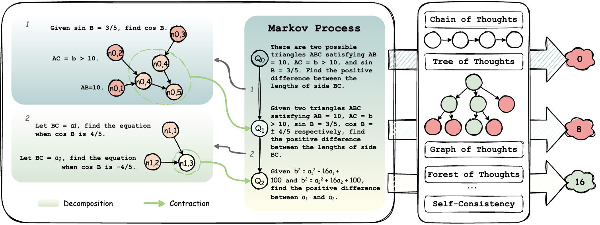

Secure your agents at: CodeAstra.dev

## AI Agent Privacy Notice

Astra Sentinel found a possible pattern where sensitive user, customer, or patient data may be passed directly into an AI agent or LLM context.

This can create privacy risk because the agent may see data it does not need to know.

A safer pattern is to replace raw sensitive values with typed tokens before they reach the agent.

Example:

Before: Book appointment for John Smith, DOB 04/12/1988
After: Book appointment for [CVT:NAME:patient_name], DOB [CVT:DOB:patient_dob]

The agent can still perform the workflow, but it never sees the raw sensitive data.

Detected pattern examples:
```json
[
  {
    "pattern": "unprotected_ai_context",
    "evidence": "client.chat.completions.create(model=model, messages=[{'role': 'user', 'content': msg}], stop=none, response_format={'type': response_format})"
  }
]
```

This notice was generated from a privacy scan. Please review before merging.

Secure your agents at: CodeAstra.dev

---

# Atom of Thoughts for Markov LLM Test-Time Scaling

<div align="center">

[](https://arxiv.org/abs/2502.12018) [](https://github.com/steamedbun/atom) [-%23000000.svg?style=for-the-badge&logo=twitter&logoColor=white)](https://x.com/didiforx/status/1895902471635288252)

<div align="center">
  
</div>

</div>

This is a official implementation of the paper [Atom of Thoughts for Markov LLM Test-Time Scaling](https://arxiv.org/abs/2502.12018).

## 📰 News

- We're thrilled by the amazing community response to our [post](https://x.com/didiforx/status/1895902471635288252) (390k+ Views) and grateful for all the engaging discussions.

## 📖 Overview

Atom of Thoughts (AoT) is a new reasoning framework that represents the solution as a composition of atomic questions. This approach transforms the reasoning process into a Markov process with atomic states, where state transitions use a two-phase mechanism: first decomposing the current question into a temporary dependency-based directed acyclic graph, then contracting its subquestions to form a new atomic question state. AoT significantly enhances large language models' performance on reasoning tasks while reducing computational waste. Additionally, these atomic states enable AoT to function as a plugin for existing test-time scaling methods, allowing for flexible integration that combines the strengths of different approaches.

**Key Features:**

- **General Reasoning Capability**: Works across diverse reasoning scenarios including math, multi-choice, and multi-hop QA with the same codebase, differentiated only by task-specific prompts
- **Plug-in Enhancement**: Can be integrated with existing test-time scaling methods to improve their performance
- **Resource Efficiency**: Focuses computational resources on effective reasoning rather than processing historical information

## ⚙️ API Configuration Setup

Before using the Atom of Thoughts (AoT) framework, you need to set up your API key and URL:

1. Create an `apikey.py` file in the project root directory with the following format:

```
url = "https://api.openai.com/v1"  # Replace with your API endpoint
api_key = [
    "your-api-key-here",  # Replace with your actual API key
    # You can add multiple API keys to improve concurrency performance.
]
```

## 🚀 Quick Start

### Atom Mode: Using AoT as a reasoning method

Evaluate the performance of AoT on a specific dataset:

```bash
python main.py --dataset math --start 0 --end 10 --model gpt-4o-mini
```

### Command Arguments

- `--dataset`: Choose from `math`, `gsm8k`, `bbh`, `mmlu`, `hotpotqa`, or `longbench`
- `--start` and `--end`: Specify the range of examples to evaluate (e.g., 0-10 for first 10 examples)
- `--model`: Model name of the LLM to use
- `--mode`: Choose between `atom` (main experiment) or `plugin` (generate contracted dataset)

The `plugin` mode enables AoT to serve as a preprocessing step that generates contracted questions which can then be fed into other reasoning frameworks. This approach combines the benefits of AoT's atomic state representation with other test-time scaling methods, allowing the contracted questions to maintain answer equivalence with the original questions while eliminating unnecessary historical information.

## 📝 Citation

```bibtex
@inproceedings{
  teng2025atom,
  title={Atom of Thoughts for Markov {LLM} Test-Time Scaling},
  author={Fengwei Teng and Quan Shi and Zhaoyang Yu and Jiayi Zhang and Yuyu Luo and Chenglin Wu and Zhijiang Guo},
  booktitle={The Thirty-ninth Annual Conference on Neural Information Processing Systems},
  year={2025},
  url={https://openreview.net/forum?id=qXSFkP0ELS}
}
```
